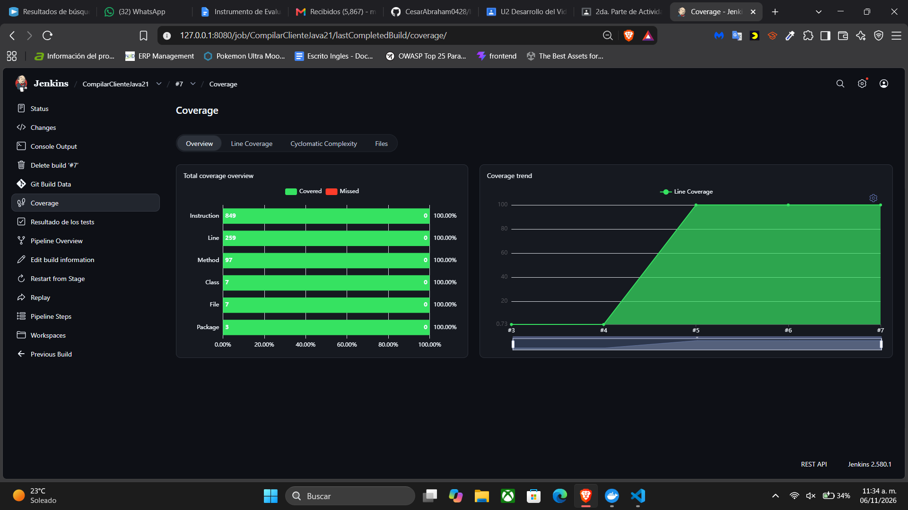
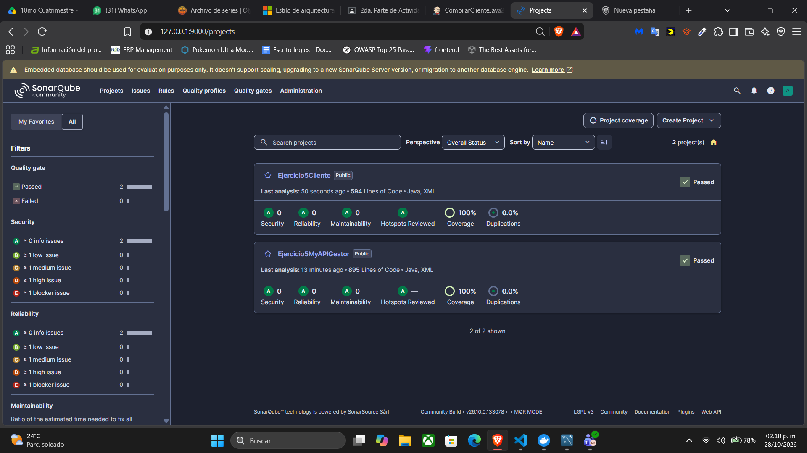
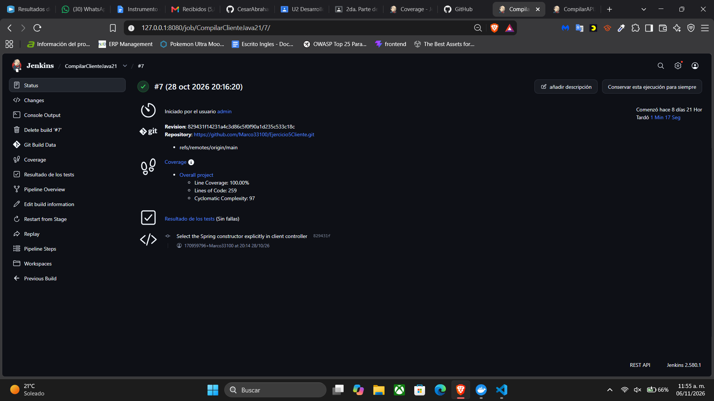
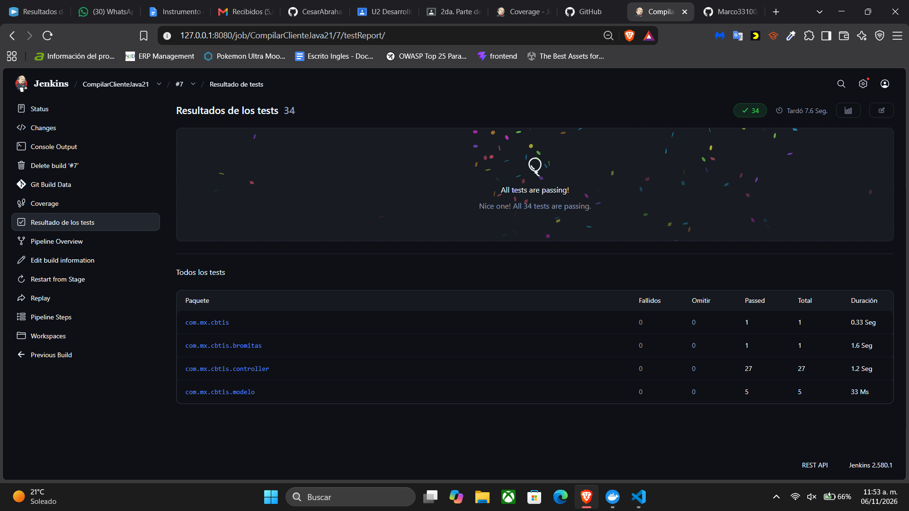

# Ejercicio5Cliente

Cliente web del gestor de proyectos con Java 21, Spring Boot 3.2.5 y Thymeleaf. Consume la API en `http://localhost:8081` por defecto; `GESTOR_API_URL` permite configurar la URL de la API en otros entornos.

## Requisitos

- JDK 21 y `JAVA_HOME` configurado con ese JDK.
- Maven Wrapper incluido, configurado con Maven 3.9.11.
- Conexión a Internet en el primer uso para resolver dependencias.


## Compilar y ejecutar en Windows

Desde la raíz del repositorio, en PowerShell:

```powershell
java -version
.\mvnw.cmd --version
.\mvnw.cmd clean verify
java -jar target/Ejercicio5Cliente-0.0.1-SNAPSHOT.jar --server.port=8082
```

Abre [http://localhost:8082](http://localhost:8082). La API y MySQL deben estar iniciados para usar las operaciones del gestor. Se utiliza 8082 para dejar 8080 a Jenkins.

En Linux o macOS utiliza `./mvnw` y configura las mismas variables de entorno si corresponde.

## Desplegar en Render con Docker

Este repositorio incluye un `Dockerfile` para publicar el cliente como **Web Service** (no como Static Site):

1. Sube estos cambios a la rama del repositorio del cliente en GitHub.
2. En Render, crea un **New > Web Service**, conecta el repositorio del cliente y selecciona **Docker** como runtime. Deja vacío **Root Directory** si el Dockerfile está en la raíz.
3. En **Environment Variables**, agrega `GESTOR_API_URL` con la URL pública HTTPS del servicio API, sin una ruta adicional; por ejemplo `https://mi-api.onrender.com`.
4. Crea el servicio. Render define `PORT` y el cliente lo usa automáticamente.

La API debe estar desplegada y conectada a MySQL antes de probar las operaciones del cliente. El servicio gratuito de Render puede tardar en responder cuando vuelve a activarse después de estar inactivo.

## Pruebas y cobertura

Resultado conservado de Jenkins **CompilarClienteJava21 #7**, verificado el **28 de octubre de 2026**: **SUCCESS**. 34 pruebas aprobadas; 97/97 métodos y 259/259 líneas cubiertos al 100 %. No hay ramas evaluables en este reporte. No hubo fallos, errores ni omisiones. Estas evidencias corresponden a esa revisión y no implican que se haya ejecutado una compilación nueva al editar este README.

Las pruebas comprueban rutas, vistas, formularios, contratos JSON, peticiones a la API y arranque real de Spring. Las llamadas HTTP se verifican con MockRestServiceServer y RestTemplate.

`clean verify` ejecuta Surefire y genera `target/site/jacoco/index.html` y `target/site/jacoco/jacoco.xml`. Coverage de Jenkins publica el XML. No se añadieron exclusiones manuales de clases o métodos. La cobertura mide ejecución del código Java; no acredita la calidad completa de las aserciones ni la cobertura visual de HTML o JavaScript.

Consulta el [detalle de cobertura](docs/cobertura-100.md).

## Jenkins

Configura las herramientas `JDK21` con ruta `/opt/java/openjdk` y `Maven3` con versión 3.9.11. Crea el trabajo **CompilarClienteJava21**, selecciona **Pipeline script** y pega el [Jenkinsfile](Jenkinsfile) completo. Activa **Use Groovy Sandbox**. El pipeline descarga `main`, muestra el POM y las versiones y ejecuta `clean verify` con `steps { dir('.') { sh ... } }`.

El trabajo publica JUnit y Coverage y ejecuta SonarQube con la clave `Ejercicio5Cliente`. Requiere JUnit, Coverage y SonarQube Scanner for Jenkins. Configura la instalación `SonarServer` y su token en Jenkins Credentials.

Un cambio del Jenkinsfile en GitHub no reemplaza automáticamente el texto de un trabajo configurado con Pipeline script. Para incorporar cambios del script, cópialo de nuevo a Jenkins.

## Herramientas Maven

El POM utiliza Java 21 y declara explícitamente Sonar Maven Plugin **5.5.0.6356**, JaCoCo **0.8.15** y Maven Surefire **3.5.4**. El análisis Sonar se ejecuta en una etapa independiente después de generar cobertura; declarar el plugin no envía un análisis por sí solo.

## Historial de la actualización

- [POM actual](pom.xml)
- [POM original](docs/pom-original.xml)
- [Cambios de Java 21 y plugins](docs/actualizacion-java21.md)
- [Repositorio de la API](https://github.com/Marco33100/Ejercicio5MyAPIGestor)


## Evidencias de pruebas y análisis

La captura compartida el **6 de noviembre de 2026** muestra el resultado conservado de **CompilarClienteJava21 #7**: **100 %**, con 97/97 métodos y 259/259 líneas. Los archivos adjuntos corresponden a la ejecución del **28 de octubre**, no a una compilación nueva.



### Reportes consultables desde GitHub

| Evidencia | Archivo o enlace |
| --- | --- |
| JaCoCo completo HTML | [Índice](evidencias/2026-10-28/jacoco/index.html) |
| JaCoCo XML | [Contadores y detalle](evidencias/2026-10-28/jacoco/jacoco.xml) |
| Pruebas JUnit | [Resumen de suites](evidencias/2026-10-28/pruebas.json) |
| Resultados Jenkins | [Resultado y extractos de consola](evidencias/2026-10-28/jenkins.json) |
| Origen e integridad | [Procedencia](evidencias/2026-10-28/ORIGEN.txt) y [SHA256](evidencias/2026-10-28/SHA256SUMS.txt) |

GitHub muestra el código de los archivos HTML. Para navegar el informe JaCoCo, descarga el repositorio completo y abre `evidencias/2026-10-28/jacoco/index.html`; conserva sus carpetas de estilos y páginas. El XML y los JSON se pueden consultar directamente en GitHub.

### Captura del análisis final de SonarQube

Evidencia compartida el **28 de octubre de 2026**: ambos proyectos aparecen con **Quality Gate aprobado**, **100 % de cobertura**, **0 incidencias de seguridad, fiabilidad y mantenibilidad** y **0 % de duplicación**. Esta imagen está guardada en GitHub y puede consultarse desde cualquier equipo, sin acceder a los servicios locales.



### Resultados de Jenkins

Capturas compartidas el **6 de noviembre de 2026** de la ejecución **#7 del 28 de octubre de 2026**. Las imágenes se muestran directamente en GitHub; no hace falta abrir Jenkins en localhost.

**Ejecución aprobada.** El estado muestra el commit analizado, cobertura de líneas del **100 %** y resultado de pruebas sin fallos.



**Pruebas automatizadas.** Jenkins registra **34 pruebas aprobadas**, **0 fallidas** y **0 omitidas**.



Los [resultados y extractos de consola](evidencias/2026-10-28/jenkins.json) y el [resumen de suites JUnit](evidencias/2026-10-28/pruebas.json) complementan las capturas. La cobertura JaCoCo y el análisis final de SonarQube se muestran arriba.

### Código y commits

- [Cobertura y pruebas del cliente](https://github.com/Marco33100/Ejercicio5Cliente/commit/54be752).
- [Análisis SonarQube del cliente](https://github.com/Marco33100/Ejercicio5Cliente/commit/dec2ca6).
- [Selección explícita del constructor](https://github.com/Marco33100/Ejercicio5Cliente/commit/829431f).
- [Historial completo](https://github.com/Marco33100/Ejercicio5Cliente/commits/main/).
